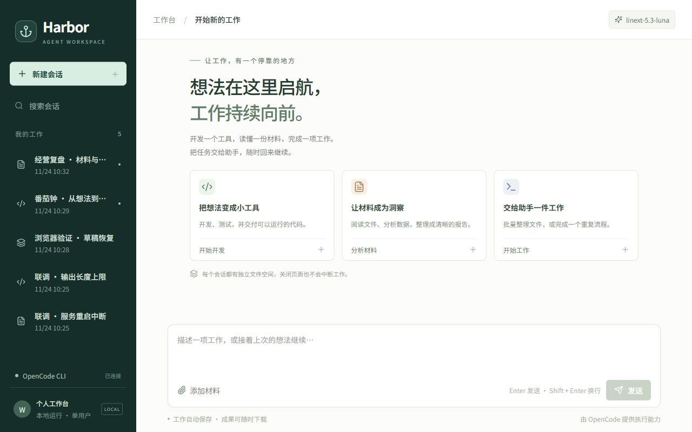

# Harbor · 云端 Agent 助手工作台

把真实的 Agent CLI 放进浏览器：创建会话，描述任务，查看工具执行过程，预览或下载代码与报告，之后回来继续。

这是一个**本机 Docker 运行、单用户使用**的完整应用。公开源码仓库：[wangzhichuan123/harbor-agent-workbench](https://github.com/wangzhichuan123/harbor-agent-workbench)。



## 快速启动

需要 Docker Desktop（Linux containers）或 Docker Engine + Compose v2。首次构建需要能访问 Docker Hub、Debian 软件源和 npm。

```sh
cp .env.example .env
# 编辑 .env，填写 AGENT_API_KEY 和 AGENT_MODEL
docker compose up -d --build --wait
```

Windows PowerShell 可使用 `Copy-Item .env.example .env`。打开 [工作台](http://localhost:3000)。

已有本地 `.env` 时请保留，不要用示例覆盖。密钥只在服务端使用；`.env`、运行数据和 CLI 状态均被 Git 与 Docker 构建上下文排除。

### 模型配置

| 变量 | 说明 |
| --- | --- |
| `AGENT_API_BASE_URL` | OpenAI-compatible API 根地址，包含 `/v1`，末尾不加 `/chat/completions` |
| `AGENT_API_KEY` | 由服务端环境传入的密钥；不要提交到仓库 |
| `AGENT_MODEL` | 支持工具调用与流式输出的实际模型名；必填 |
| `AGENT_REASONING_EFFORT` | 默认 `low`；通过兼容 SDK 传入 `reasoning_effort`，须由提供方支持 |
| `PORT` | 本机端口，默认 `3000` |
| `MAX_CONCURRENT_RUNS` | 同时执行数，默认 2，最大 4 |
| `RUN_TIMEOUT_MS` | 每轮最长时间，默认 600000 毫秒 |
| `DATA_DIR` | 仅本机 Node 运行使用；Docker 固定 `/data` |
| `AGENT_CLI` | 仅本机 Node 运行使用的 OpenCode 可执行文件路径 |

可用模型以提供方实际返回为准。此次演示使用 `linext-5.3-luna`，临时凭据到期后需更换。若本机有 Node 20.19+，可以运行：

```sh
npm ci
npm run check:models
```

此脚本只查询模型目录，不会生成内容。更改模型或密钥后，运行 `docker compose up -d --force-recreate` 使环境生效；普通 `restart` 不会加载变更后的环境变量。

## 使用

1. 点击“新建会话”，命名并选择代码开发、日常工作或自由任务。类型只用于组织，不限制助手能力。
2. 直接描述目标，或先点“添加材料”。支持拖拽上传；每次最多 10 个、每个最多 20 MB，重名自动编号，原文件不会被覆盖。
3. 发送任务后展开执行记录，查看 CLI 实际使用的工具、参数和输出。最多两个会话同时运行；同一会话每次只执行一轮。
4. 在右侧工作成果中打开文件。Markdown 直接阅读，源码按文本显示；独立 HTML 可以点击“运行预览”。二进制或大文件请下载查看。
5. 继续提出修改意见，CLI 会恢复同一个会话，保留上下文和已有文件。可以切换会话、刷新或关闭浏览器，服务端继续运行。
6. 点击单文件“下载”或“下载完整工作区”获取 ZIP。会话支持重命名；删除会话会清除其历史、文件和 CLI 状态，删除前会确认。

上传材料位于 `uploads/`；助手被要求将交付物写入 `artifacts/`。文件面板也会列出工作区内其他普通文件。隐藏文件、符号链接、依赖目录与 CLI 内部数据不对浏览器暴露。

### 任务失败或中断

- **模型错误 / 额度 / 凭据失效**：错误保存在该轮记录中，已有文件保留。修复服务端配置后可继续。
- **达到输出长度限制**：明确显示本轮未完成；可缩小任务，或调整推理强度、提供方输出额度后继续。
- **停止**：终止该 CLI 的进程组，包括子进程；保留现有文件。停止排队任务不会启动 CLI。
- **超时**：自动终止执行，显示超时状态，允许继续。
- **断网 / SSE 断开**：浏览器自动重连，按持久化事件 ID 补回进度；后台任务继续。
- **服务重启**：已完成记录与文件恢复；执行中的任务标为“执行中断”，不自动重试，避免重复操作；排队任务会继续调度。

服务端进程、容器或 Docker 停止时，任务无法继续运行；“关闭页面不中断”依赖 Docker 服务仍在运行。

## 真实 Agent CLI 接入

使用 **OpenCode 1.2.27**，Docker 构建时从 npm 安装并核验版本。没有模拟生产 Agent，也没有自己实现模型工具循环。

```text
浏览器 React
  ├─ REST：会话 / 上传 / 执行 / 文件
  └─ SSE：带 ID 的持久化事件流
        ↓
Node.js + Express
  ├─ SQLite（sql.js，事务后原子写盘）
  ├─ 每会话工作目录和 CLI 数据目录
  └─ 受限并发队列 → OpenCode CLI 子进程
                           ↓
                 OpenAI-compatible Chat Completions
                           ↓
                 CLI 自己读写文件 / 执行 Shell / 迭代
```

每轮使用 `spawn`、`shell:false` 启动 `opencode run --format json --model workbench/<model>`。用户提示通过 stdin 输入。首次运行从 JSON 事件提取 CLI 会话 ID，后续传入 `--session`。CLI 的数据、配置、缓存、状态目录按会话设置 XDG 路径，全部位于持久卷。

采用固定 1.x CLI 的 `provider` / `npm` / `options` 配置形状，并使用 `@ai-sdk/openai-compatible`；不要直接套用 OpenCode 2.x 的配置。CLI 配置由服务端通过 `OPENCODE_CONFIG_CONTENT` 提供，密钥使用环境变量替换。

只有 CLI 正常退出且收到最终 `step_finish:stop` 才算成功；`length`、错误、信号终止或缺少完成事件均不会伪装成完成。测试使用独立的协议 fixture，生产入口始终调用真实 CLI。

## 演示与验证

- [演示材料](demo/materials/)：虚构销售 CSV 与会议补充材料。
- [完整演示脚本](demo/prompts.md)：代码开发、材料分析、两类后续追问与多会话操作。
- `npm run demo`：通过已运行应用创建两个会话、上传材料、并行运行首轮与后续要求，下载真实成果并保存脱敏事件到 `docs/evidence/`。会消耗模型调用额度，并新建会话。
- [验证记录](docs/verification.md)：实际执行结果、截图与限制。
- [证据目录](docs/evidence/)：真实会话事件、生成文件、工作区 ZIP 和浏览器截图。

```sh
npm ci
npm test
npm run build
npm audit --registry=https://registry.npmjs.org
docker compose ps
```

自动测试不调用模型 API。覆盖文件隔离、越界与链接访问、同名上传、跨站请求、并发排队、同会话互斥、取消、CLI 恢复参数、SSE 回放、下载、错误脱敏、缺失完成事件、关联删除和重启中断恢复。

### 本机开发

```sh
npm ci
# 本机另行安装固定版本 CLI：npm install -g opencode-ai@1.2.27
npm run build
npm start
```

需要前端热更新时，另开终端运行 `npx vite`，访问其提示的地址。Node 后端仍使用 3000；不要与 Docker 版占用同一端口。生产 Docker 直接提供构建后的界面。

## 数据与运维

`workbench-data` Docker 命名卷包含 SQLite、上传、成果与 CLI 会话状态。`docker compose down` 保留命名卷，`docker compose down -v` **会永久删除所有工作**。

```sh
docker compose logs --tail 100
docker compose stop
docker compose cp workbench:/data ./backup-data
docker compose start
```

备份目录可能包含上传材料和模型日志，勿上传到公开仓库。应用使用单 Node 进程；不要启动多个实例共享同一数据目录。更换宿主机时迁移整个数据目录/卷，才能同时恢复工作台和 CLI 历史。

## 已知限制与取舍

- **仅用于可信用户的本机环境**。没有登录、多租户或公网访问能力。Compose 只绑定 `127.0.0.1`；API 检查 Host、Origin 与跨站请求。不要改成公开端口直接部署。
- CLI 会真实执行命令。容器非 root，删除 Linux capabilities，并启用 no-new-privileges、进程/内存限制；未挂载宿主机工作目录或 Docker socket。
- **会话目录是逻辑隔离，不是安全沙箱**。同一容器同一 UID 的 Shell 仍可能读取其他会话或环境中的服务凭据。CLI 自带的路径权限与提示约束不能阻止恶意 Shell。生产场景应每会话独立容器、隔离凭据代理与网络出口，并加入审批策略。
- 提供方应支持标准流式 Chat Completions 和工具调用。其他协议需要适配；模型能力、网络、额度和输出限制决定任务效果。不会自动重跑有副作用的任务。
- 单文件上传最多 20 MB，但没有总磁盘配额。SQLite 由 sql.js 驻内存并逐次原子导出；适合轻量单用户，长期大量日志应迁移原生 SQLite/WAL 与事件分页。文件面板最多遍历 12 层 / 约 1500 个文件。
- 进度以 CLI JSON 完整文本段、工具结束事件为粒度，不承诺逐 token 显示；不展示模型内部推理。工具失败内容保存在执行记录中，CLI 可以继续自行修复。
- 预览只运行**自包含 HTML**，使用无同源权限的 sandbox iframe 与 CSP，禁用网络、表单提交。多文件网站、外部依赖、后端程序请下载后按其说明运行。Python、Node、Git、ripgrep 在镜像中；PDF/Office/OCR 解析库需用户任务自行安装，未预装完整办公套件。
- 上传与下载不是文件版本控制；覆盖修改会影响当前文件。执行过程中禁止上传以减少材料竞争。完整版本历史与可视化 diff 尚未提供。
- SSE 和队列状态保存在服务端，多个浏览器可读取同一单用户工作台；浏览器未发送草稿只存当前浏览器 localStorage。
- 没有自动发布功能；更新公开仓库前请检查提交内容与密钥排除情况。

## 获取源码与提交更新

公开仓库包含完整源码、README、虚构演示材料与实际运行证据：

```sh
git clone https://github.com/wangzhichuan123/harbor-agent-workbench.git
cd harbor-agent-workbench
```

本地仓库的 `origin` 已关联该地址。提交后续更新时，先扫描跟踪文件、ZIP 内容与全部提交历史：

```sh
git status
python scripts/check_secrets.py --history
git push -u origin main
```

不要添加 `.env`、运行卷、`node_modules` 或私人上传材料。仓库内的演示数据为虚构，API 凭据不在源码、镜像层或演示证据中。

## 参考

- [OpenCode 固定版本源码](https://github.com/anomalyco/opencode/tree/v1.2.27)
- [OpenCode 1.2.27 非交互运行实现](https://github.com/anomalyco/opencode/blob/v1.2.27/packages/opencode/src/cli/cmd/run.ts)
- [AI SDK 兼容提供方参数](https://ai-sdk.dev/providers/openai-compatible-providers)

## License

项目源码采用 [MIT](LICENSE)，OpenCode 和依赖遵循各自许可证。
