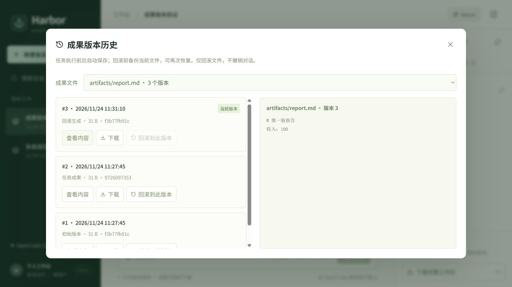
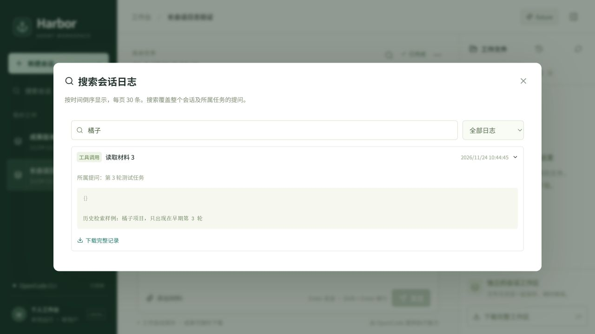

# 演示任务

本演示使用文字步骤、实际成果和截图，无需视频。先展示代码开发与日常工作，再补充成果回滚、日志分页和搜索。

## 查看已有演示成果

本机 Docker 的原始演示数据仍在时，可直接打开以下会话；重新克隆仓库不会附带运行卷，会话不存在时按后面的提示词新建。

| 场景 | 浏览器操作 | 已完成的证据 |
| --- | --- | --- |
| 代码开发与后续修改 | 打开[番茄钟会话](http://localhost:3000/?session=04910674-156e-49b1-87fa-8fbb79eb35c5)，查看两轮需求、展开执行记录，打开 `artifacts/pomodoro.html` 并点击“运行预览” | [真实会话截图](../docs/evidence/03-code-session.jpg)、[HTML 实际运行](../docs/evidence/04-html-preview.jpg)、[生成代码的 31 项测试](../docs/evidence/generated-code-tests.txt) |
| 日常工作与后续交流 | 切换到[经营复盘会话](http://localhost:3000/?session=76d7e51c-3170-4068-bed7-7eca201079b8)，查看上传材料、`review.md`、`summary.csv` 和后续行动清单 | [报告预览](../docs/evidence/05-report-preview.jpg)、[独立数据核验](../docs/evidence/artifact-verification.json) |
| 多会话与继续工作 | 在两会话间切换、刷新页面，确认各自的对话、执行记录和文件保留；下载一个文件或工作区 ZIP | [上传与草稿恢复](../docs/evidence/02-upload-and-draft.jpg)、[Docker 重启核验](../docs/evidence/restart-verified.json) |
| 新功能 | 按下方“成果版本回滚”“长会话日志分页与搜索”步骤展示 | [回滚截图](../docs/evidence/07-version-rollback.jpg)、[跨页搜索截图](../docs/evidence/08-history-search.jpg)、[完整验证记录](../docs/verification.md#成果版本日志分页与搜索) |

下面四段提示词用于从头复现真实 CLI 任务。`npm run demo` 会自动执行这四轮并保存新的演示证据，消耗模型额度；执行前请备份需要保留的 `docs/evidence/`。仅查看已保存的截图、日志和成果不会调用模型。

## 代码开发 · 第 1 轮
开发一个独立的离线 HTML 番茄钟，不使用外部依赖。支持 25 分钟专注、5 分钟休息、开始、暂停、重置。保存为 artifacts/pomodoro.html。另写一段 Node 可执行的核心逻辑测试并实际运行。用中文说明成果路径、使用方式和验证结果。不要启动长期服务器。

## 代码开发 · 后续交流
继续修改刚才的番茄钟：增加自定义专注时长（1–60 分钟）与已完成专注次数，切换阶段不能重复计数；保留现有功能。补充并运行测试。

## 日常工作 · 第 1 轮
读取 uploads/sales.csv 和 uploads/meeting-notes.txt，整理 8–10 月经营复盘。计算各月总收入、按渠道的收入趋势、退款率（退款额/收入）和毛利（收入-cost），明确缺少哪些净利润数据。保存 artifacts/review.md 和 artifacts/summary.csv；用实际脚本交叉核验总计，报告引用材料文件名，不捏造原因。

## 日常工作 · 后续交流
在上次分析基础上，为 11 月生成一份可执行的行动清单，包含负责人、截止日期、指标和待验证假设，保存 artifacts/action-plan.md。仅使用材料中已有的负责人；日期可以作为建议并明确标注。

## 多会话演示
代码会话运行时，创建日常工作会话并上传两个材料文件，发送任务。切换回代码会话查看进展；刷新页面确认仍可看到历史。待两者完成，分别提出以上后续要求。点击 HTML 成果“运行预览”，查看 Markdown 报告，下载单文件或工作区 ZIP。运行 `docker compose restart` 后，确认历史与文件仍在；如有执行中的任务，会被标记中断，可以继续。

## 成果版本回滚

从头复现时，在**升级后新建的代码会话**执行上述首轮和后续修改：两轮会修改同一个 `artifacts/pomodoro.html`，会留下至少两个内容版本。原始演示在版本功能上线前已完成，因此旧会话目前只有升级时建立的初始版本，不能用它展示升级前两版之间的回滚。

1. 等待任务完成，在文件面板右上角点击“成果版本历史”，选择 `artifacts/pomodoro.html`。
2. 查看早期版本的内容或下载，确认其属于增加自定义时长与计数之前的文件，再点击“回滚到此版本”并确认。
3. 关闭版本面板，打开当前文件“运行预览”，确认内容已恢复；两轮聊天和测试文件仍保留。这里只回滚 HTML 单文件，不是整个工作区。
4. 再打开版本历史，确认出现“回滚生成”，刚才的新版本仍可恢复。回滚到含自定义时长的版本，再运行预览，展示回滚本身也可逆。
5. 如果继续让助手修改，先明确告诉它“我刚才回滚了 HTML，请先重新读取文件再修改”，因为 CLI 会话上下文不会随文件回滚。

已有浏览器验证使用独立测试会话，将报告“收入 200”回滚为“收入 100”，第 3 个版本标为“回滚生成”，第 2 个版本仍保留可恢复。**此截图来自协议 fixture 的功能验证，不是一次新的真实模型报告任务。** 原始真实 CLI 演示证据另见上表。

## 长会话日志分页与搜索

实际浏览器验证用独立测试环境准备了 45 轮对话、每轮 3 条事件；生产环境的真实演示每会话只有两轮，不会出现“加载更早对话”。这些测试记录用于稳定复现边界，没有调用模型 API，也不计作真实 Agent 完成的 45 次任务。

| 步骤 | 操作 | 实际观察与验收点 |
| --- | --- | --- |
| 初始分页 | 打开长会话 | 先显示最近 20 / 45 轮，不一次加载全部对话 |
| 跨页搜索 | **先不加载旧对话**，点击会话标题旁放大镜，搜索“橘子” | 命中仅出现在第 3 轮的工具输出；展开后显示所属提问，可下载完整记录 |
| 日志分页 | 清空查询 | 初始 30 条，点击“加载更早日志”后为 60 条，按时间倒序追加 |
| 对话分页 | 关闭搜索，点击“加载更早对话”两次 | 已显示数按 20 → 40 → 45 变化，最后不再显示加载按钮；早期执行记录可以展开 |
| 类型筛选 | 在搜索面板选择“工具调用”“助手回复”或“状态与错误” | 仅显示所选类别；可配合关键词检索 |

这段演示可直接使用上述真实浏览器截图与[验证记录](../docs/verification.md#成果版本日志分页与搜索)讲解。自动复查运行 `npm test`：测试另外用 65 轮、195 条事件覆盖游标分页无遗漏/重复、中文字面查询、筛选和 SSE 多批回放，不需要为演示消耗几十轮模型调用。

## 演示收尾

展示[26 项应用测试结果](../docs/evidence/feature-tests.txt)和[版本重启核验](../docs/evidence/versions-restart-verified.json)，说明成果、日志和版本保存在 Docker 卷中。关闭浏览器不会停止任务；停止 Docker 后任务不能继续。版本没有自动清理配额，已有文件的升级前历史无法补回。

演示涉及两种不同证据：代码开发、材料分析是实际 OpenCode CLI + 模型运行；长会话边界与回滚截图是隔离 fixture 的功能验证。两者均可在仓库中查看，不能把 fixture 日志说成真实模型运行。
