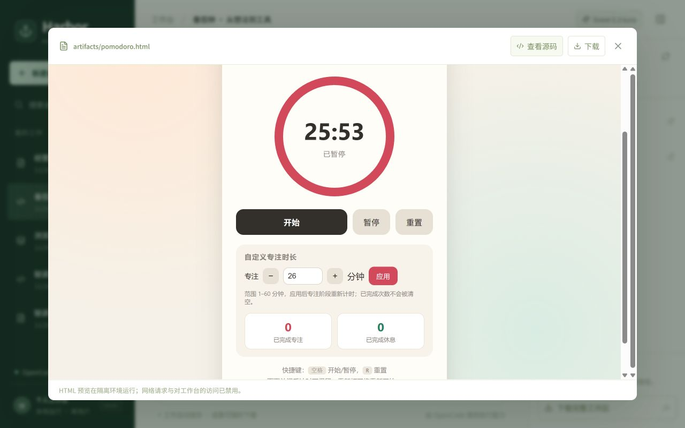
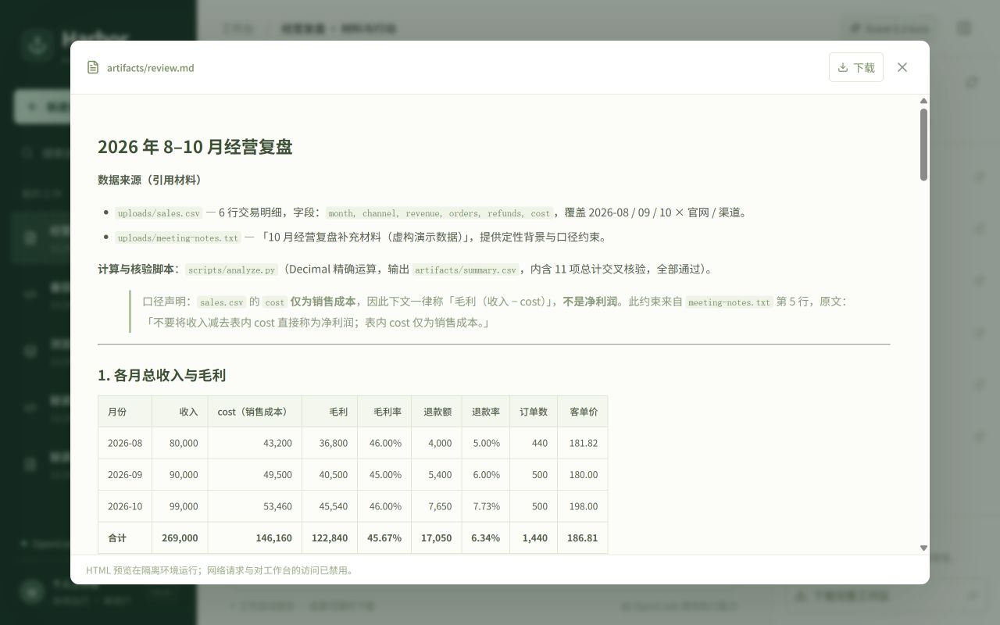
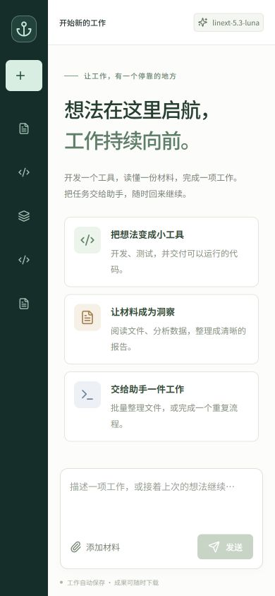

# 实际运行与验证记录

验证日期：2026-11-24（北京时间）。所有模型调用都来自所开发应用中的真实 OpenCode CLI；没有使用临时 API 辅助编写应用源码。

## 运行环境

- Windows 宿主机、Docker Desktop Linux engine 29.1.3、Compose v2.40.3。
- 实际构建并启动 `harbor-agent-workbench:local`，容器健康，映射 `127.0.0.1:3000`。
- 容器内 Node `v22.23.5`，OpenCode `1.2.27`，非 root 用户 `node`。
- 模型目录返回 `linext-5.3-luna`，使用用户提供的兼容 API。密钥在未跟踪 `.env` 中，仅经环境注入容器。
- 最终镜像摘要：`sha256:afd2e18a422f4a6eb994e8998e6d3603846d82b7fd7858e2b0a3179efe406ff6`。

## 代码开发与后续交流

会话 `04910674-156e-49b1-87fa-8fbb79eb35c5`，共 2 轮，均为 `completed`；61 条持久化事件、25 次实际工具调用。

1. 开发可离线运行的单 HTML 番茄钟，支持专注、休息、开始、暂停和重置；CLI 写文件并实际运行 Node 测试。
2. 通过同一个 CLI 会话继续修改，加入 1–60 分钟自定义时长、专注完成计数和防重复计数，扩展测试。

真实交付物：

- [pomodoro.html](evidence/code/artifacts/pomodoro.html)
- [pomodoro.test.js](evidence/code/artifacts/pomodoro.test.js)
- [会话事件与回复](evidence/code-session.json)
- [完整工作区 ZIP](evidence/code-workspace.zip)

独立将原样生成的 HTML 与测试复制到临时目录运行，**31 项测试通过**。测试从交付 HTML 提取核心脚本，未替换为另一份实现。额外检查 HTML 没有外部 src/href 依赖。[实际输出](evidence/generated-code-tests.txt)。

浏览器中实际点击“运行预览”，将时长从 25 增至 26 并应用，开始后观察到倒计时，再暂停显示 `25:53 / 已暂停`；重置、切换休息、切回专注后为 `26:00 / 准备开始`，完成次数仍为 0。计时结束与防重边界由上述逻辑测试验证，未在浏览器中等待完整 26 分钟。




## 日常工作与后续交流

会话 `76d7e51c-3170-4068-bed7-7eca201079b8`，共 2 轮，均为 `completed`；101 条持久化事件、39 次实际工具调用。

1. 经应用上传 `sales.csv` 与 `meeting-notes.txt`，CLI 读取材料、运行 Python 脚本，生成经营复盘与汇总 CSV。
2. 继续同一会话，要求以已有负责人生成含建议截止日期、指标与待验证假设的行动清单。

真实交付物：

- [经营复盘](evidence/work/artifacts/review.md)
- [汇总 CSV](evidence/work/artifacts/summary.csv)
- [行动清单](evidence/work/artifacts/action-plan.md)
- [会话事件与回复](evidence/work-session.json)
- [完整工作区 ZIP（含 CLI 生成并运行的分析脚本）](evidence/work-workspace.zip)

独立从原始 6 行 CSV 重新计算，并比对所有月份与汇总行：收入 **269,000**、销售成本 **146,160**、退款额 **17,050**、按任务定义毛利 **122,840**，全部一致。报告明确该数值不是净利润，列出广告、人员等缺失成本，并保留“退货原因尚未核实”的材料约束。[独立核验结果](evidence/artifact-verification.json)。

行动清单是基于虚构材料生成的演示成果，日期、任务指派与目标是建议，不是已批准的安排；其中包含当月已过去日期及延伸至 12 月的任务，使用前需要结合当前日期重新排期。这属于生成内容的质量边界，工作台不会将模型建议自动提交到外部系统。



## 多会话、上传与页面恢复

- `npm run demo` 同时提交两类任务，二者在不同工作目录与 CLI 状态目录中并行执行，随后分别进行后续交流。
- 浏览器实际新建“浏览器验证 · 草稿恢复”会话、输入未发送草稿、刷新，草稿恢复；通过浏览器文件选择器上传 `sales.csv`，材料列表显示 258 B，点击后可读 CSV 内容。
- 在两个真实会话间切换，均可查看两轮历史、工具记录和自己的成果文件。
- API 验证单文件下载及 ZIP 签名；ZIP 包含材料、代码/报告与辅助脚本。
- 桌面 `1280×800` 与移动端 `390×844` 检查布局；移动端默认收起文件面板，侧边会话图标保留可访问名称。
- 最终浏览器控制台读取到的错误列表为空。




## Docker 重启持久化

真实任务完成后，先记录两个会话的轮次 ID、状态、事件数及**所有工作文件 SHA-256**，再执行最终镜像替换和 `docker compose restart`，随后重新读取比较：两会话、四轮历史、162 条事件、全部文件哈希完全一致。

- [重启前基线](evidence/live-baseline.json)
- [重启后比较结果](evidence/restart-verified.json)
- 可复查：`node scripts/verify-live.mjs --compare`

## 异常与边界验证

真实首次联调出现模型仅产生推理并达到输出长度上限、没有交付内容的情况。应用没有标记成功。根据该问题加入明确的 `length` 错误提示，并将兼容模型默认推理强度配置为 `low`，随后四轮演示全部完成。[首次长度限制记录](evidence/initial-output-limit.json)。

联调期间实际更新容器，正在执行的任务被保留为 `interrupted`，已有材料与文件仍存在；没有自动重跑。[真实中断记录](evidence/initial-interrupted.json)。首次版本的退出提示仅展示了 CLI 初始化日志，最终版本已改为缺少完成事件/长度限制的可理解说明。

最终自动化测试：**9 项通过、0 失败**。[完整 TAP 输出](evidence/automated-tests.txt)。这些测试使用明确标注的 CLI 协议 fixture，不消耗模型 API，覆盖：

- 会话与文件隔离、路径越界与链接阻断、同名上传保留原件、跨站请求拒绝。
- 并发队列、同会话互斥、运行期间删除保护、进程取消与超时。
- 后续轮次必须携带 CLI `--session`，SSE 按 ID 回放，单文件和 ZIP 下载。
- 错误可见与密钥脱敏，零退出但缺少完成事件仍判失败，输出长度限制提示。
- 删除会话级联清理执行与事件、服务重启后运行任务标为中断。

应用依赖的 npm 官方审计：**0 项漏洞**，详见 [审计 JSON](evidence/npm-audit.json)。这不等于完整的容器安全审计，也未覆盖全局安装的 CLI 自身依赖。

## 复现

```sh
npm ci
npm test
npm run build
docker compose up -d --build --wait
npm run demo
node scripts/validate-artifacts.mjs
node scripts/verify-live.mjs
docker compose restart
docker compose up -d --wait
node scripts/verify-live.mjs --compare
```

真实模型有随机性，重跑的内容、耗时与工具次数可能不同。`validate-artifacts.mjs` 对此次演示的交付结构作断言，如果新演示生成了不同字段结构，应人工复核后调整核验脚本，不能把“CLI 正常结束”直接等同于内容正确。
