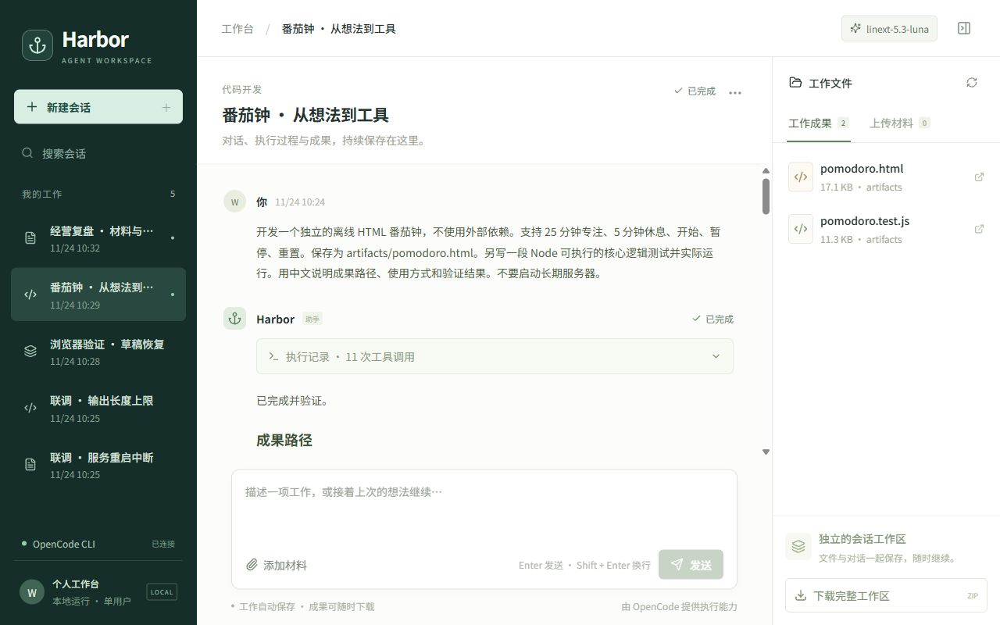
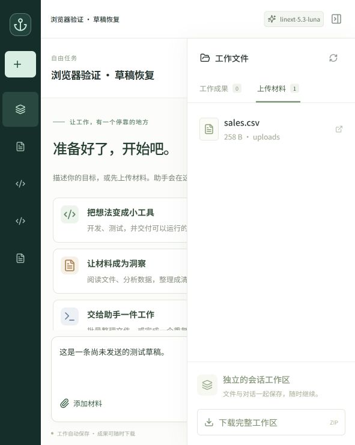
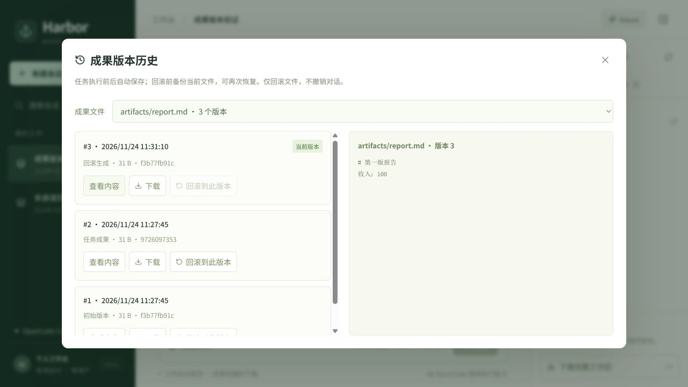
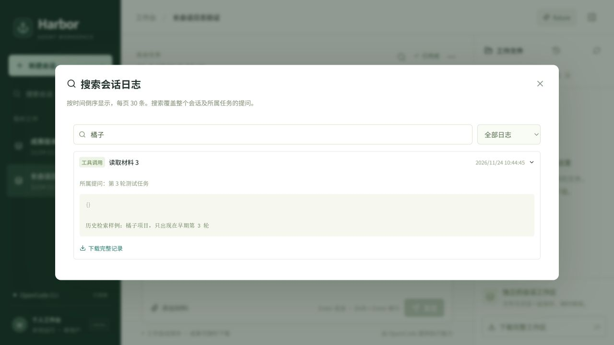

# 实际运行与验证记录

验证日期：2026-11-24（北京时间）。所有模型调用都来自所开发应用中的真实 OpenCode CLI；没有使用临时 API 辅助编写应用源码。

## 运行环境

- Windows 宿主机、Docker Desktop Linux engine 29.1.3、Compose v2.40.3。
- 实际构建并启动 `harbor-agent-workbench:local`，容器健康，映射 `127.0.0.1:3000`。
- 容器内 Node `v22.23.5`，OpenCode `1.2.27`，非 root 用户 `node`。
- 模型目录返回 `linext-5.3-luna`，使用用户提供的兼容 API。密钥在未跟踪 `.env` 中，仅经环境注入容器。
- 首轮验收镜像摘要：`sha256:afd2e18a422f4a6eb994e8998e6d3603846d82b7fd7858e2b0a3179efe406ff6`。

## 代码开发与后续交流

会话 `04910674-156e-49b1-87fa-8fbb79eb35c5`，共 2 轮，均为 `completed`；61 条持久化事件、25 次实际工具调用。

1. 开发可离线运行的单 HTML 番茄钟，支持专注、休息、开始、暂停和重置；CLI 写文件并实际运行 Node 测试。
2. 通过同一个 CLI 会话继续修改，加入 1–60 分钟自定义时长、专注完成计数和防重复计数，扩展测试。

真实交付物：

- [pomodoro.html](evidence/code/artifacts/pomodoro.html)
- [pomodoro.test.js](evidence/code/artifacts/pomodoro.test.js)
- [会话事件与回复](evidence/code-session.json)
- [完整工作区 ZIP](evidence/code-workspace.zip)

独立将原样生成的 HTML 与测试复制到临时目录运行，**31 项测试通过**。测试从交付 HTML 提取核心脚本，未替换为另一份实现。额外检查 HTML 没有外部 src/href 依赖。[实际输出](evidence/generated-code-tests.txt)。

浏览器中实际点击“运行预览”，将时长从 25 增至 26 并应用，开始后观察到倒计时，再暂停显示 `25:53 / 已暂停`；重置、切换休息、切回专注后为 `26:00 / 准备开始`，完成次数仍为 0。计时结束与防重边界由上述逻辑测试验证，未在浏览器中等待完整 26 分钟。




## 日常工作与后续交流

会话 `76d7e51c-3170-4068-bed7-7eca201079b8`，共 2 轮，均为 `completed`；101 条持久化事件、39 次实际工具调用。

1. 经应用上传 `sales.csv` 与 `meeting-notes.txt`，CLI 读取材料、运行 Python 脚本，生成经营复盘与汇总 CSV。
2. 继续同一会话，要求以已有负责人生成含建议截止日期、指标与待验证假设的行动清单。

真实交付物：

- [经营复盘](evidence/work/artifacts/review.md)
- [汇总 CSV](evidence/work/artifacts/summary.csv)
- [行动清单](evidence/work/artifacts/action-plan.md)
- [会话事件与回复](evidence/work-session.json)
- [完整工作区 ZIP（含 CLI 生成并运行的分析脚本）](evidence/work-workspace.zip)

独立从原始 6 行 CSV 重新计算，并比对所有月份与汇总行：收入 **269,000**、销售成本 **146,160**、退款额 **17,050**、按任务定义毛利 **122,840**，全部一致。报告明确该数值不是净利润，列出广告、人员等缺失成本，并保留“退货原因尚未核实”的材料约束。[独立核验结果](evidence/artifact-verification.json)。

行动清单是基于虚构材料生成的演示成果，日期、任务指派与目标是建议，不是已批准的安排；其中包含当月已过去日期及延伸至 12 月的任务，使用前需要结合当前日期重新排期。这属于生成内容的质量边界，工作台不会将模型建议自动提交到外部系统。


## 多会话、上传与页面恢复

- `npm run demo` 同时提交两类任务，二者在不同工作目录与 CLI 状态目录中并行执行，随后分别进行后续交流。
- 浏览器实际新建“浏览器验证 · 草稿恢复”会话、输入未发送草稿、刷新，草稿恢复；通过浏览器文件选择器上传 `sales.csv`，材料列表显示 258 B，点击后可读 CSV 内容。
- 在两个真实会话间切换，均可查看两轮历史、工具记录和自己的成果文件。
- API 验证单文件下载及 ZIP 签名；ZIP 包含材料、代码/报告与辅助脚本。
- 桌面 `1280×800` 与移动端 `390×844` 检查布局；移动端默认收起文件面板，侧边会话图标保留可访问名称。
- 最终浏览器控制台读取到的错误列表为空。




## Docker 重启持久化

真实任务完成后，先记录两个会话的轮次 ID、状态、事件数及**所有工作文件 SHA-256**，再执行最终镜像替换和 `docker compose restart`，随后重新读取比较：两会话、四轮历史、162 条事件、全部文件哈希完全一致。

- [重启前基线](evidence/live-baseline.json)
- [重启后比较结果](evidence/restart-verified.json)
- 可复查：`node scripts/verify-live.mjs --compare`

## 异常与边界验证

真实首次联调出现模型仅产生推理并达到输出长度上限、没有交付内容的情况。应用没有标记成功。根据该问题加入明确的 `length` 错误提示，并将兼容模型默认推理强度配置为 `low`，随后四轮演示全部完成。[首次长度限制记录](evidence/initial-output-limit.json)。

联调期间实际更新容器，正在执行的任务被保留为 `interrupted`，已有材料与文件仍存在；没有自动重跑。[真实中断记录](evidence/initial-interrupted.json)。首次版本的退出提示仅展示了 CLI 初始化日志，最终版本已改为缺少完成事件/长度限制的可理解说明。

首轮自动化测试：**9 项通过、0 失败**。[完整 TAP 输出](evidence/automated-tests.txt)。这些测试使用明确标注的 CLI 协议 fixture，不消耗模型 API，覆盖：

- 会话与文件隔离、路径越界与链接阻断、同名上传保留原件、跨站请求拒绝。
- 并发队列、同会话互斥、运行期间删除保护、进程取消与超时。
- 后续轮次必须携带 CLI `--session`，SSE 按 ID 回放，单文件和 ZIP 下载。
- 错误可见与密钥脱敏，零退出但缺少完成事件仍判失败，输出长度限制提示。
- 删除会话级联清理执行与事件、服务重启后运行任务标为中断。

应用依赖的 npm 官方审计：**0 项漏洞**，详见 [审计 JSON](evidence/npm-audit.json)。这不等于完整的容器安全审计，也未覆盖全局安装的 CLI 自身依赖。

## 后续边界复查

2026-11-24 再次检查并修复以下问题，扩展后自动化测试 **14 项全部通过**：

- 发送期间切换会话，只清理实际已发送且未继续编辑的草稿；其他会话草稿保留。
- 迟到的 REST 响应不会覆盖更新的 SSE 事件，完成状态不会回退到执行中。
- 文件预览请求绑定原会话和请求序号；切换会话或关闭后，旧请求不能重新弹出预览。
- 存在后台任务时，每 5 秒同步侧栏状态；浏览器重新获得焦点时也会刷新。
- 长助手回复保留完整内容并继续脱敏；过长的工具日志明确显示截断提示。
- 中文长文件名按 UTF-8 字节控制长度并保留扩展名，避免 Linux 文件名长度错误；文件列表严格限制 1500 项，并容忍扫描时文件刚被移走。
- CLI 开始新步骤后清除上一步的完成标记，避免后续步骤中断被误判为成功。

浏览器回归使用独立的 `localhost:3001` 协议 fixture 环境，刻意将发送和预览请求延迟 1.8 秒，未调用模型 API：实际确认跨会话发送后 B 草稿保留、发送期间继续编辑的新草稿保留、A 文件预览不会在 B 弹出，以及停留在 B 时 A 的后台完成状态能同步。测试环境与正式 Docker 服务分开，以上真实模型演示证据保持不变。

本轮 Docker 构建和启动通过，并再次比较首轮两会话四轮历史及全部文件哈希，结果一致。当前源码仍保留单用户、逻辑目录隔离和自包含 HTML 预览等已说明的限制。

## 成果版本、日志分页与搜索

2026-11-24 新增并验证三项功能，自动化测试扩展为 **26 项通过、0 失败**：[本轮完整 TAP 输出](evidence/feature-tests.txt)。测试使用独立 CLI 协议 fixture；此次功能验证未调用模型 API。原有真实 OpenCode 代码开发和日常工作两类演示保持不变。

- 执行前后保存成果变更；旧数据建立初始版本。回滚先保存未归档的当前内容，回滚操作可逆，支持删除状态恢复、二进制文件跨块备份；损坏历史内容校验失败时不会覆盖当前文件。
- 正在排队/执行时拒绝回滚；版本不能跨会话访问，符号链接和越界路径不能用于恢复。重新加载存储后，历史元数据与内容保持一致。
- 用 65 轮、195 条事件验证 REST 游标分页无遗漏/重复、日志类型筛选、中文与 `%_` 字面查询、所属提问检索、长日志完整记录下载，以及多批 SSE 回放。
- 实时事件保留最近 200 条，350 段助手回复保持完整；过期快照不会覆盖更新状态。另验证突发日志超过一页时仍可继续分页访问中间内容。

浏览器实际在独立 `localhost:3001` 测试环境操作：将“收入 200”的第二版报告回滚成“收入 100”的第一版，界面新增“回滚生成”的第 3 个版本，第二版仍可选择恢复。下图为实际回滚后状态。



45 轮测试会话先显示最近 20 轮；此时搜索“橘子”，实际命中尚未加载的第 3 轮工具输出。清除查询后初始 30 条日志，点击加载变为 60 条；关闭搜索后对话按 20 → 40 → 45 轮追加，最终无更多按钮，早期单轮执行记录可以展开。浏览器控制台错误列表为空。



正式 Docker 镜像已更新并实际重启，两个真实演示会话自动建立共 **8 份初始文件版本**。重启后再次逐个下载历史内容，SHA-256、大小和版本元数据与基线完全一致；原有两会话四轮、162 条事件及所有当前文件哈希也与最初基线一致。新镜像 manifest：`sha256:e6545f3c62efa5b1a667b1c152a18b0f414046d13e20230d6d9b1354bfa05dab`。

- [版本重启前基线](evidence/versions-baseline.json)
- [版本重启后核验](evidence/versions-restart-verified.json)
- 复查命令：重启前 `node scripts/verify-versions.mjs --baseline`，重启后 `node scripts/verify-versions.mjs --compare`。

初始版本只能保存升级时仍存在的文件，无法恢复升级前已被覆盖的版本。快照在任务边界保存，未提供逐工具命令快照、整工作区回滚或可视化 diff。界面已分页，但 sql.js 仍将整个数据库驻内存，版本也没有自动清理配额；这些限制已同步到 README。

## 复现

```sh
npm ci
npm test
npm run build
docker compose up -d --build --wait
npm run demo
node scripts/validate-artifacts.mjs
node scripts/verify-live.mjs
docker compose restart
docker compose up -d --wait
node scripts/verify-live.mjs --compare
```

真实模型有随机性，重跑的内容、耗时与工具次数可能不同。`validate-artifacts.mjs` 对此次演示的交付结构作断言，如果新演示生成了不同字段结构，应人工复核后调整核验脚本，不能把“CLI 正常结束”直接等同于内容正确。
